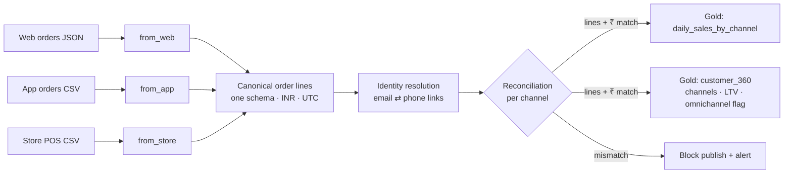

# Unified Omnichannel Retail Platform

**Inspired by my work at Furlenco** · PySpark · canonical data model · customer identity resolution · reconciliation

A retailer that sells through a **website, a mobile app and physical stores** ends up with three very different order feeds and no single view of sales or customers. This project unifies them into **one trusted, reconciled order-line model**, matches the same shopper across channels, and publishes reporting tables that every team reads with the same definitions.

> **Independent portfolio project.** It recreates the *kind* of retail data platform I built at Furlenco, from scratch, with **synthetic data**. It contains no Furlenco code, data, schemas or business logic and is not affiliated with Furlenco.

---

## The problem in the data

| Channel | Format | Quirks the platform handles |
|---|---|---|
| Web | nested JSON (order → items[]) | mixed-case emails, ISO timestamps with offsets |
| App | flat CSV, one row per line | amounts in **paise**, timestamps in **epoch milliseconds**, phone only |
| Store POS | CSV from billing counters | phone typed by cashiers (`+91 98450 12345`, `098450-12345`...), `dd-MM-yyyy` dates, store codes instead of cities, walk-ins with no phone |

## Architecture



## Key pieces

- **Channel adapters** (`src/omni/channels.py`): one small function per source maps it to the canonical model. Adding a channel such as a marketplace means writing one more adapter.
- **Normalisation:** emails lower-cased and validated; phones reduced to a valid 10-digit Indian mobile number; amounts converted to INR decimals; timestamps to UTC.
- **Identity resolution** (`src/omni/identity.py`): deterministic, explainable rules. Web orders link an email to a phone, so an app-only or store purchase with that phone joins the same `customer_id`. Walk-ins stay anonymous instead of being force-matched.
- **Reconciliation** (`src/omni/quality.py`): for every channel, line counts **and** ₹ totals must match the source before Gold is published.
- **Customer 360:** channels used, orders, lifetime value, first and last order, and an `is_omnichannel` flag.

## Run it

```bash
pip install -r requirements.txt
python scripts/make_sample_data.py --out data/raw
PYTHONPATH=src python -m omni.build --raw data/raw --out output
pytest -q
```

## On Microsoft Fabric

Each channel lands in a Lakehouse folder through a Data Pipeline Copy activity. `omni.build` runs as a notebook with `--format delta`, and the reconciliation result decides whether the pipeline continues to the semantic-model refresh. Gold tables feed a Direct Lake Power BI model, giving one sales number for every team.

## Tech

Python · PySpark · Spark SQL · canonical data modelling · source-to-target mapping · identity resolution · data reconciliation · Microsoft Fabric · pytest · GitHub Actions
