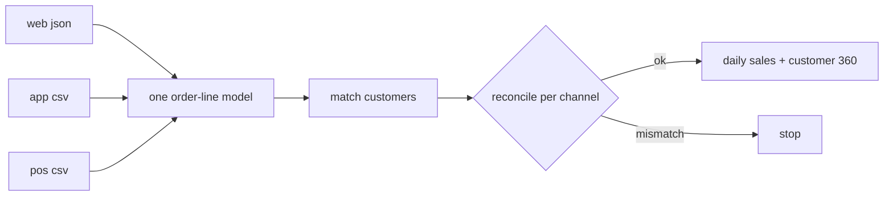

# omnichannel-retail-platform

Takes orders from three channels (website, mobile app and store billing counters) and turns them into one order-line table that everyone can report from. It also works out which customers are the same person across channels.

Based on the kind of retail data platform I worked on at Furlenco, rebuilt in a simplified form with **made-up data**. No company code, data or schemas are in here.

## The messy part

Each channel sends data differently:

| channel | format | annoying bits |
|---|---|---|
| web | nested JSON, items inside each order | emails in random case |
| app | flat CSV | money in **paise**, timestamps in epoch millis, no email, only phone |
| store POS | CSV from the billing counter | phone numbers typed every possible way (`+91 98450 12345`, `098450-12345`...), `dd-MM-yyyy` dates, store codes instead of city |

## What it does



- `channels.py`: one small function per channel that maps it to the common columns (order_id, channel, order_ts in UTC, city, sku, quantity, amount in INR, email, phone)
- `identity.py`: customer matching. Web orders have both email and phone, which links the two, so if the same phone shows up on an app order it becomes the same customer. No phone or email means an anonymous walk-in. I kept the rules simple and deterministic on purpose so the business can understand why two records were merged.
- `quality.py`: before publishing, line counts **and** rupee totals per channel have to match the source. This catches the case where the row count looks fine but the amounts don't.
- `gold.py`: daily sales by channel and city, plus a small customer 360 (channels used, orders, lifetime value, omnichannel flag).

## Running it

```bash
pip install -r requirements.txt
python scripts/make_sample_data.py --out data/raw
PYTHONPATH=src python -m omni.build --raw data/raw --out output
pytest -q
```

## Things I'd improve

- Matching is exact on email/phone. Fuzzy matching on name and address would catch more, but it also needs a review step.
- Returns and refunds aren't modelled yet; everything delivered counts as a sale.
- On Fabric I'd run `build` from a pipeline and only refresh the Power BI model if reconciliation passes.
